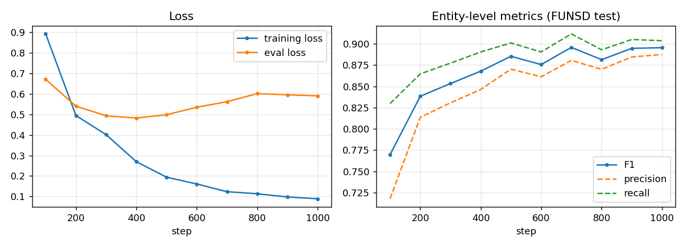
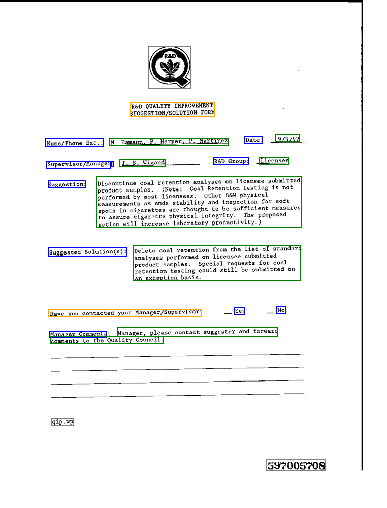

# LayoutLMv3 Form Understanding on FUNSD

Fine-tuning LayoutLMv3 to read scanned forms: every word is labelled as a **question** (field name), **answer**
(filled-in value), **header** or **other**, and questions are then linked to their answers to give key-value output.
The notebook also includes a Tesseract OCR path for documents that come without annotations.

[](notebooks/layoutlmv3_funsd.ipynb)
[](LICENSE)

```
scanned page → OCR (words + boxes) → boxes normalised to 0–1000 → LayoutLMv3 (text + layout + image)
             → BIO token labels → entity grouping → question/answer linking
```

## Results

Entity-level scores (seqeval) on the 50 FUNSD test forms after 1,000 steps:

| Precision | Recall | F1 | Token accuracy |
|:---:|:---:|:---:|:---:|
| 0.888 | 0.904 | **0.896** | 0.856 |

This is in line with the ~0.90 F1 reported for LayoutLMv3-base in the paper. Fine-tuning took under 5 minutes on a
single GPU.

<p align="center"></p>

F1 levels off around step 700 (best 0.896), while evaluation loss is lowest at step 400 and rises afterwards. The
model becomes more confident on the training forms without losing entity F1, but a shorter schedule or early
stopping would be enough.

## Data

[FUNSD](https://guillaumejaume.github.io/FUNSD/) (Jaume et al., 2019): 199 noisy scanned forms, 149 for training
and 50 for testing, with a box and a label for every word. I used the pre-formatted
[`nielsr/funsd-layoutlmv3`](https://huggingface.co/datasets/nielsr/funsd-layoutlmv3) version.

<p align="center"></p>
<p align="center"><sub>Gold annotations on a training form: question in blue, answer in green, header in orange.</sub></p>

## Method

| | |
|---|---|
| Model | `microsoft/layoutlmv3-base` + token classification head, 7 BIO labels (125.3 M parameters) |
| Preprocessing | `AutoProcessor` with `apply_ocr=False`: page resized to 224 × 224, words tokenised with their box; only the first sub-token of each word is labelled, the rest get `-100` |
| Training | HF `Trainer`, lr 1e-5, batch size 2, 1,000 steps (~13 epochs), max length 512 |
| Evaluation | seqeval entity-level precision / recall / F1 every 100 steps |
| Inference | first-sub-token prediction per word, BIO grouping into entities, nearest-answer heuristic for key-value linking |

## Running it

```bash
pip install -r requirements.txt
sudo apt-get install tesseract-ocr   # only needed for the OCR section
jupyter notebook notebooks/layoutlmv3_funsd.ipynb
```

The dataset and the base model download automatically from the Hugging Face Hub.

## Limitations

- FUNSD has no separate validation set, so the test split was also used to monitor training. A held-out part of the
  training set would give a cleaner final number.
- The saved run stops after the evaluation. Sections 8–11 (inference, OCR, key-value linking, saving) were not
  executed, and the Tesseract install failed on that machine (no root access). The code is there, but I have no
  OCR or key-value results to report yet.
- Key-value linking is a distance heuristic; a learned relation-extraction head would handle multi-column layouts
  better.
- With real scans, end-to-end quality is bounded by the OCR, since the model can only label the words Tesseract
  finds.

## Repository structure

```
.
├── notebooks/layoutlmv3_funsd.ipynb   # preprocessing, fine-tuning, evaluation, OCR inference, KV linking
├── docs/figures/                     # figures used in this README
├── requirements.txt
└── LICENSE
```

## References

- Y. Huang, T. Lv, L. Cui, Y. Lu and F. Wei, *LayoutLMv3: Pre-training for Document AI with Unified Text and Image Masking*, ACM MM 2022. arXiv:2204.08387
- G. Jaume, H. K. Ekenel and J.-P. Thiran, *FUNSD: A Dataset for Form Understanding in Noisy Scanned Documents*, ICDAR-OST 2019
- The fine-tuning setup follows N. Rogge's [Transformers-Tutorials](https://github.com/NielsRogge/Transformers-Tutorials) (LayoutLMv3 on FUNSD)

## License

The notebook code is under the [MIT License](LICENSE). FUNSD is licensed for non-commercial research use, and the
LayoutLMv3 weights are released by Microsoft under CC BY-NC-SA 4.0, so a model fine-tuned here inherits those
non-commercial terms.
